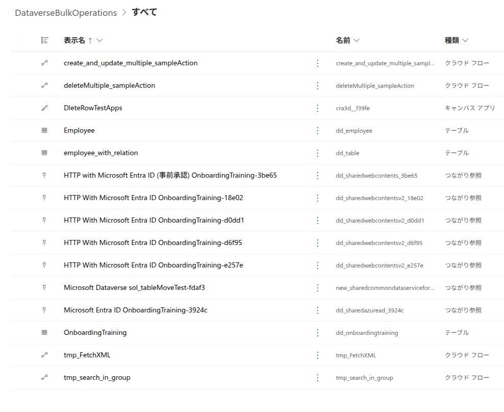

# Dataverse Bulk Operations

[日本語](./README.md) | English

A Power Platform solution for experimenting with Dataverse Web API bulk operations. It includes cloud flows for creating, updating, and deleting multiple rows, along with a canvas app and tables for testing.

## Solution Components

| Type | Name | Description |
|---|---|---|
| Cloud flow | `create_and_update_multiple_sampleAction` | Sample bulk create and update operations using the Dataverse Web API `CreateMultiple` and `UpdateMultiple` messages |
| Cloud flow | `deleteMultiple_sampleAction` | Retrieves Dataverse rows and deletes them in batches using the Web API `$batch` endpoint |
| Cloud flow | `tmp_FetchXML` | Sample Dataverse row retrieval using FetchXML |
| Cloud flow | `tmp_search_in_group` | Sample Microsoft Entra ID group membership check |
| Canvas app | `DeleteRowTestApps` | App for testing delete operations |
| Dataverse tables | `Employee`, `employee_with_relation`, `OnboardingTraining` | Tables for testing the flows and app |

The solution display name is `DataverseBulkOperations`. The unique solution name and ZIP filename use `OnboardingTraining`.

## Files

- Solution: [`OnboardingTraining_1_0_0_1.zip`](./solution/OnboardingTraining_1_0_0_1.zip) (version 1.0.0.1, unmanaged)
- Solution contents: [AllItems.png](./screenshots/AllItems.png)

## Import and Use

1. In the target environment, open **Solutions** in Power Apps.
2. Select **Import solution** and choose the ZIP file above.
3. Configure the connection references during import. The solution includes Dataverse, Microsoft Entra ID, and HTTP with Microsoft Entra ID connections.
4. After import, verify each flow's connections, target environment, and tables before running it with test data.

Create or assign the required connections in the target environment. The solution does not include environment-specific connection credentials.

## Guides

- [Installation Guide](./docs/install-guide.en.md)
- [Setup Guide](./docs/setup-guide.en.md)
- [インストール手順 (Japanese)](./docs/install-guide.md)
- [セットアップガイド (Japanese)](./docs/setup-guide.md)

## Important Notes

- This solution is a sample. Test it thoroughly in a development or test environment before importing it into production.
- `deleteMultiple_sampleAction` retrieves and deletes rows from the `dd_employees` table without a filter. Review the table data and back it up if needed before running the flow.
- Bulk request limits and requirements depend on Dataverse. Test with representative data volumes before use.

## License

This repository is licensed under the [MIT License](../../LICENSE).
