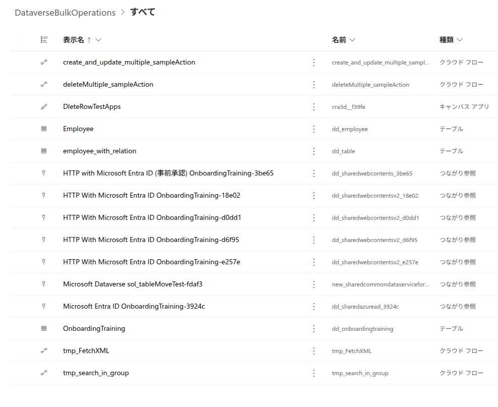

# Dataverse Bulk Operations

日本語 | [English](./README.en.md)

Dataverse Web API の一括操作を試すための Power Platform ソリューションです。複数行の作成・更新・削除を行うクラウドフローと、動作確認用のキャンバスアプリやテーブルを含みます。

## ソリューションの内容

| 種類 | 名前 | 概要 |
|---|---|---|
| クラウドフロー | `create_and_update_multiple_sampleAction` | Dataverse Web API の `CreateMultiple` / `UpdateMultiple` を使った一括作成・更新のサンプル |
| クラウドフロー | `deleteMultiple_sampleAction` | Dataverse の行を取得し、Web API の `$batch` で一括削除するサンプル |
| クラウドフロー | `tmp_FetchXML` | FetchXML を使った Dataverse 行の取得サンプル |
| クラウドフロー | `tmp_search_in_group` | Microsoft Entra ID のグループメンバーシップ確認サンプル |
| キャンバスアプリ | `DeleteRowTestApps` | 削除操作の確認用アプリ |
| Dataverse テーブル | `Employee`、`employee_with_relation`、`OnboardingTraining` | フローおよびアプリの動作確認用テーブル |

ソリューションの表示名は `DataverseBulkOperations` です。ZIP 内のソリューション名およびファイル名は `OnboardingTraining` になっています。

## ファイル

- ソリューション: [`OnboardingTraining_1_0_0_1.zip`](./solution/OnboardingTraining_1_0_0_1.zip)（バージョン 1.0.0.1、アンマネージド）
- ソリューション内の項目一覧: [AllItems.png](./screenshots/AllItems.png)

## インポートと利用

1. Power Apps の対象環境で **ソリューション** を開きます。
2. **ソリューションのインポート** を選び、上記 ZIP ファイルを指定します。
3. インポート時に接続参照を設定します。Dataverse と Microsoft Entra ID 用の HTTP 接続が含まれます。
4. インポート後、各フローの接続と対象環境・テーブルを確認してから、テストデータで実行します。

接続参照や環境に応じた設定は、インポート先で用意してください。このソリューションには環境固有の接続情報は含まれません。

## ガイド

- [インストール手順](./docs/install-guide.md)
- [セットアップガイド](./docs/setup-guide.md)
- [Installation Guide (English)](./docs/install-guide.en.md)
- [Setup Guide (English)](./docs/setup-guide.en.md)

## 注意事項

- このソリューションはサンプルです。本番環境へインポートする前に、開発・テスト環境で十分に動作を確認してください。
- `deleteMultiple_sampleAction` は `dd_employees` テーブルの行を条件なしで取得して削除します。実行前に対象テーブルのデータを確認し、必要なデータのバックアップを取ってください。
- 一括操作のリクエスト上限や利用条件は Dataverse の仕様に従います。実際のデータ量で検証してから利用してください。

## ライセンス

このリポジトリは [MIT License](../../LICENSE) です。